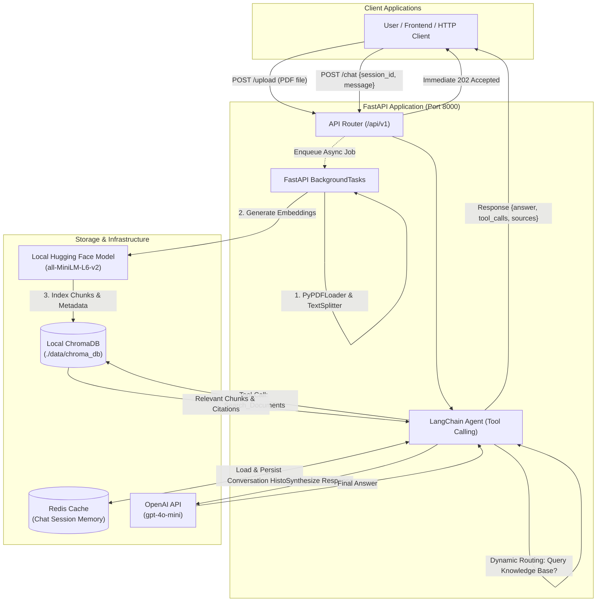

# RAG-Powered Knowledge Base API

A production-ready, asynchronous RESTful API built for document question-answering using **Retrieval-Augmented Generation (RAG)**, **LangChain agentic tool calling**, **local ChromaDB vector persistence**, and **Redis-backed session conversation memory**.

---

## 🏗 Architecture Overview



### Key Architectural Highlights
1. **Asynchronous, Non-Blocking Ingestion:** File upload returns an immediate HTTP `202 Accepted` response while document parsing (`PyPDFLoader`), semantic chunking (`RecursiveCharacterTextSplitter`), and vector indexing run in the background via FastAPI `BackgroundTasks`.
2. **Local, Zero-Cost Embeddings:** Uses Hugging Face's `sentence-transformers/all-MiniLM-L6-v2` locally on CPU/CUDA, avoiding vendor lock-in and per-token embedding fees.
3. **Persistent Vector Storage:** Retains vectors locally on disk using `ChromaDB.PersistentClient` (`./data/chroma_db`).
4. **Stateful Conversation Memory with TTL:** Uses Redis to maintain multi-turn chat history per `session_id`, configured with automatic expiration (TTL) to prevent cache bloat.
5. **Intelligent Dynamic Routing:** An LLM agent equipped with tool-calling capability dynamically routes between direct conversational responses (for greetings/chitchat) and vector search (for domain queries).

---

## 🛠 Tech Stack

- **Framework:** [FastAPI](https://fastapi.tiangolo.com/) (Python 3.10+)
- **Server:** [Uvicorn](https://www.uvicorn.org/) (ASGI)
- **Validation & Settings:** [Pydantic v2](https://docs.pydantic.dev/) & [pydantic-settings](https://docs.pydantic.dev/latest/concepts/pydantic_settings/)
- **LLM Orchestration:** [LangChain](https://www.langchain.com/) (Agents, Tools, Prompts)
- **LLM Provider:** [OpenAI API](https://platform.openai.com/) (`gpt-4o-mini`)
- **Vector Database:** [ChromaDB](https://www.trychroma.com/) (Local disk persistence)
- **Embedding Model:** [Hugging Face Sentence Transformers](https://huggingface.co/sentence-transformers/all-MiniLM-L6-v2) (`all-MiniLM-L6-v2`)
- **Memory & Cache:** [Redis](https://redis.io/) (`redis.asyncio` with TTL retention)
- **Document Processing:** [PyPDF](https://pypdf.readthedocs.io/)

---

## 📁 Project Structure

```
├── app/
│   ├── __init__.py
│   ├── main.py                  # FastAPI app factory, lifespan context, and middleware
│   ├── api/
│   │   ├── __init__.py
│   │   ├── routes.py            # System health and runtime info endpoints
│   │   ├── upload.py            # POST /upload endpoint with BackgroundTasks
│   │   └── chat.py              # POST /chat endpoint with agent tool calling
│   ├── core/
│   │   ├── __init__.py
│   │   ├── config.py            # Pydantic BaseSettings loading from .env
│   │   └── database.py          # Redis connection pool and ChromaDB PersistentClient
│   └── services/
│       ├── __init__.py
│       ├── embeddings.py        # Hugging Face sentence-transformers singleton
│       ├── vector_store.py      # LangChain Chroma vector store integration
│       ├── ingestion.py         # PyPDFLoader and RecursiveCharacterTextSplitter worker
│       ├── memory.py            # RedisSessionMemory with TTL expiration
│       └── chat_agent.py        # LangChain Agent with Search_Documents tool
├── data/
│   └── chroma_db/               # Local persistent Chroma vector store (gitignored)
├── uploads/                     # Temporary upload buffer (gitignored)
├── .env.example                 # Environment variables configuration template
├── .gitignore                   # Excludes environments, secrets, and local databases
├── requirements.txt             # Pinned Python dependencies
└── README.md                    # Project documentation
```

---

## 📋 Prerequisites

1. **Python 3.10+** installed on your system.
2. **Redis Server:**
   - Run locally, or via Docker:
     ```bash
     docker run -d --name redis-local -p 6379:6379 redis:alpine
     ```
3. **OpenAI API Key:** For agent reasoning and final answer synthesis (obtainable from [platform.openai.com](https://platform.openai.com/api-keys)).

---

## 🚀 Local Setup & Installation

### 1. Clone & Navigate to Repository
```bash
git clone <your-repo-url>
cd "Knowledge base"
```

### 2. Create & Activate a Virtual Environment
```bash
# On Linux/macOS:
python3 -m venv .venv
source .venv/bin/activate

# On Windows (PowerShell):
python -m venv .venv
.venv\Scripts\Activate.ps1
```

### 3. Install Dependencies
```bash
pip install -r requirements.txt
```

### 4. Configure Environment Variables
Copy the template configuration file:
```bash
cp .env.example .env
```
Open `.env` and fill in your values (specifically your `OPENAI_API_KEY` and `REDIS_URL`):
```env
OPENAI_API_KEY="sk-proj-..."
REDIS_URL="redis://localhost:6379/0"
CHROMA_PERSIST_DIR="./data/chroma_db"
EMBEDDING_MODEL_NAME="sentence-transformers/all-MiniLM-L6-v2"
LLM_MODEL_NAME="gpt-4o-mini"
```

### 5. Start the API Server
```bash
uvicorn app.main:app --reload --host 0.0.0.0 --port 8000
```
The server will start at `http://localhost:8000`.

- **Interactive Swagger UI:** [http://localhost:8000/docs](http://localhost:8000/docs)
- **ReDoc Documentation:** [http://localhost:8000/redoc](http://localhost:8000/redoc)

---

## 🧪 Testing with cURL

### 1. System Health Check
Verifies connectivity to Redis and ChromaDB:
```bash
curl -X GET http://localhost:8000/api/v1/health
```
**Example Response:**
```json
{
  "status": "healthy",
  "timestamp": "2026-11-10T17:40:00.000000Z",
  "environment": "development",
  "services": {
    "redis": { "status": "connected", "url": "redis://localhost:6379/0" },
    "chromadb": { "status": "connected", "type": "PersistentClient (Local)", "collections_count": 1 }
  }
}
```

---

### 2. Upload Document (`POST /upload`)
Uploads a PDF document. The API responds immediately while ingestion runs asynchronously in the background:
```bash
curl -X POST http://localhost:8000/upload \
  -F "file=@sample_report.pdf"
```
**Example Response (`202 Accepted`):**
```json
{
  "status": "accepted",
  "message": "File 'sample_report.pdf' uploaded successfully. Parsing and embedding have started in the background.",
  "task_id": "7c48f8fa-b413-461d-84db-6c5df53ff24d",
  "filename": "sample_report.pdf",
  "file_size_bytes": 142058
}
```

---

### 3. Chat Endpoint (`POST /chat`)

#### Scenario A: Casual Greeting (Direct Response without Vector Search)
The agent recognizes this is conversational and does **not** call `Search_Documents`:
```bash
curl -X POST http://localhost:8000/chat \
  -H "Content-Type: application/json" \
  -d '{
    "session_id": "user-session-001",
    "message": "Hi there! What are your capabilities?"
  }'
```
**Example Response:**
```json
{
  "session_id": "user-session-001",
  "query": "Hi there! What are your capabilities?",
  "answer": "Hello! I am your knowledge base assistant. You can upload PDF documents and ask me specific questions about their contents. I will search the documents and provide answers with citations.",
  "tool_calls": [],
  "sources": []
}
```

#### Scenario B: Document Question (Agent Invokes `Search_Documents`)
The agent determines that context is required, calls the vector database tool, and synthesizes the answer:
```bash
curl -X POST http://localhost:8000/chat \
  -H "Content-Type: application/json" \
  -d '{
    "session_id": "user-session-001",
    "message": "What are the primary findings mentioned in the uploaded report?"
  }'
```
**Example Response:**
```json
{
  "session_id": "user-session-001",
  "query": "What are the primary findings mentioned in the uploaded report?",
  "answer": "According to the report, the primary findings show a 28% improvement in retrieval speed through local caching, alongside a 14% reduction in memory overhead.",
  "tool_calls": ["Search_Documents"],
  "sources": ["sample_report.pdf"]
}
```

#### Scenario C: Multi-Turn Conversation (Redis Session Memory)
The agent remembers previous messages within the same `session_id`:
```bash
curl -X POST http://localhost:8000/chat \
  -H "Content-Type: application/json" \
  -d '{
    "session_id": "user-session-001",
    "message": "Can you summarize that in two bullet points?"
  }'
```

---

### 4. Clear Session Memory (`DELETE /chat/{session_id}`)
Purges session conversation history from Redis:
```bash
curl -X DELETE http://localhost:8000/chat/user-session-001
```
**Example Response:**
```json
{
  "session_id": "user-session-001",
  "status": "success",
  "message": "Conversation memory for session 'user-session-001' has been cleared."
}
```

---

## 📄 License
MIT License. Open-source for portfolio and educational use.

